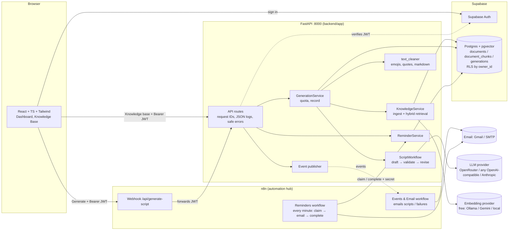

# Script-AI 2.0 Architecture

## Components



**Generation path:** browser → n8n webhook → FastAPI `/api/generate-script` (cleans the output with `text_cleaner`) → n8n "Respond to Webhook" → browser. Anything placed after the respond node runs as automation, after the user already has the script.

**Knowledge base, email and reminder paths:** browser → FastAPI directly. Email features then reach the user through n8n:
- **Email me / background generation:** FastAPI sends `script.email_requested` → n8n Events & Email workflow → Send Email.
- **Reminders:** stored in Postgres. Every minute the n8n Reminders workflow calls `/api/internal/reminders/claim` (with the shared secret), emails each due reminder, then reports `/complete`. Failed sends are retried up to 3 times.

**Events:** FastAPI → n8n `/webhook/scriptai-events`, fire-and-forget with the `X-ScriptAI-Secret` header.

Production leaves `VITE_N8N_WEBHOOK_URL` empty, so the frontend calls FastAPI directly. n8n (in Docker, exposed through an ngrok static domain) still receives events and sends every email. If n8n is down, generation keeps working; only email and reminder delivery pause.

## Request flow: generate a script

1. The dashboard sends `POST /api/generate-script` with the Supabase access token, either to the n8n webhook (which forwards the `Authorization` header) or directly to FastAPI.
2. `get_current_user` verifies the JWT. `sub` becomes the owner ID, and `app_metadata.subscription` sets the quota tier. Users can't edit `app_metadata`, so they can't raise their own tier.
3. `GenerationService.check_quota` counts today's successful generations for that user.
4. If `use_knowledge_base` is set, `KnowledgeService.retrieve` runs **hybrid search**:
   - pgvector cosine search and Postgres full-text search (OR of query terms), both filtered by `owner_id` and `status='ready'`;
   - reciprocal rank fusion (k=60) merges the two ranked lists;
   - **relevance gate**: a hit is kept only if similarity ≥ `RAG_MIN_SIMILARITY`, or if it contains at least 50% of the query terms. An unrelated brief therefore gets no "sources".
   - If retrieval fails, generation continues without context and reports `knowledge_base.status = "unavailable"`.
5. `ScriptWorkflow` runs:
   - `draft`: one LLM call. The system prompt holds the rules, the user prompt holds the brief, and retrieved text sits inside `<reference_documents>` as **data**. Malformed JSON gets one repair retry.
   - `validate`: deterministic checks, with no model call (word target, required keywords, call to action, placeholders, citations that don't match any reference, tweet length).
   - `revise_n`: **assisted mode only**, at most `MAX_AGENT_REVISIONS` times, and only while the step budget `MAX_AGENT_STEPS` allows. A revision that is worse is thrown away. If a revision fails at the provider, the best draft so far is returned.
6. Each section passes through `app/services/text_cleaner.py` (emojis, unwanted quotes, markdown, list spacing). Only sources the model **cited** and that were **actually retrieved** come back as `metadata.sources`.
7. A metadata-only record goes into `generations`: no topic text and no script, but status, validation, sources, tokens, cost, and duration.

## Request flow: ingest a document

```
upload → validate (extension, size, magic bytes, UTF-8, no NUL) → sha256 dedupe
       → status=processing → extract (pypdf per page / text) → normalize
       → chunk (paragraph packing, never crosses page/heading, overlap within a section,
                section title prepended as a contextual header)
       → embed (batched) → replace_chunks (transaction) → status=ready
         └─ any failure → status=failed + error_code, safe 4xx/5xx to the client
```

## Trust boundaries

| Boundary | Control |
|---|---|
| Browser → API | Bearer JWT verified server-side. CORS allows only `FRONTEND_ORIGINS`. All input is validated by pydantic (enums, lengths, UUIDs). |
| API → database | Every query filters by `owner_id`, and RLS adds a second layer for direct client access. |
| Uploaded files | Treated as hostile: limited by size and type, checked by content, with page limits and safe parse errors. |
| Retrieved text → LLM | Delimited as data. Tags that could close the data block are stripped. The model never chooses tools or actions. |
| LLM output → user | Schema-validated, cleaned, and checked by rules. Citations are mapped back to real chunks. |
| FastAPI ↔ n8n | One shared secret (`X-ScriptAI-Secret`) in both directions. Events never contain uploaded document text. Delivery is fire-and-forget, so it can't block users. Internal reminder endpoints reject user tokens. |
| Email recipients | Always the verified login email from the JWT. Clients can't choose a recipient, so the system can't be used as a spam relay. |
| Logs | JSON with secret redaction (keys, bearer tokens, JWTs, DB URLs). No document text or prompts. |

## Data lifecycle

- Raw uploaded files are **not stored**. Only extracted chunks and their embeddings are kept.
- Deleting a document removes its chunks through `ON DELETE CASCADE`.
- Generation records hold metadata only. The script text lives in the user's browser.

## Where the code is

| Concern | File |
|---|---|
| Settings (every env var) | `backend/app/core/config.py` |
| Auth | `backend/app/core/auth.py` |
| Errors and HTTP mapping | `backend/app/core/errors.py` |
| Logging and redaction | `backend/app/core/logging.py` |
| LLM clients | `backend/app/services/llm.py` |
| Embeddings | `backend/app/services/embeddings.py` |
| Prompts | `backend/app/services/prompts.py` |
| Workflow (agent) | `backend/app/services/agent_workflow.py` |
| Validation rules | `backend/app/services/validation.py` |
| Output cleaning | `backend/app/services/text_cleaner.py` |
| Events to n8n | `backend/app/services/events.py` |
| Reminders | `backend/app/services/reminders.py`, `backend/app/api/reminders.py` |
| n8n workflows | `n8n/*.workflow.json` |
| Retrieval and ingestion | `backend/app/services/knowledge.py`, `document_ingestion.py` |
| Storage | `backend/app/repositories/{memory,postgres}.py` |
| Schema | `backend/migrations/001_init.sql` |
